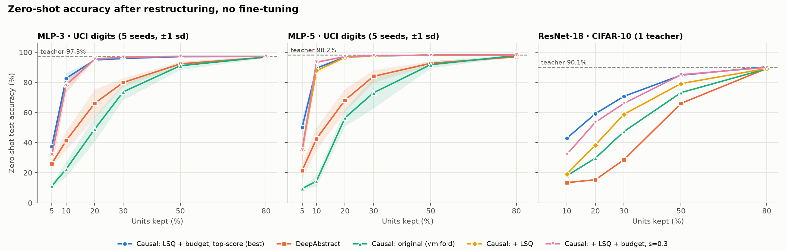
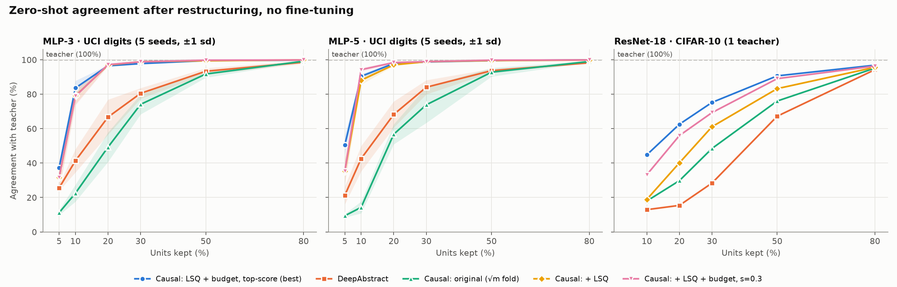
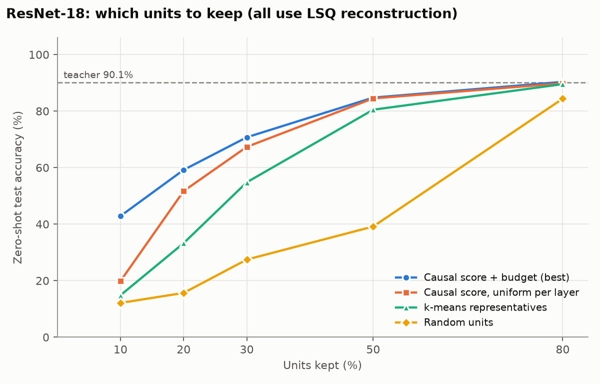

# Causual Mechanistic Interpretability Pipeline

## Quick Start
To get started with the CMI (Causual Mechanistic Interpretability) Pipeline, first you must clone the repository onto your machine locally. You can do this with the following command:
```bash
git clone https://github.com/Suave101/CausualMechanisticInterpretability.git
```
Then you must set your current directory to the CMI repository:
```bash
cd CausualMechanisticInterpretability
```
After that, you must download the required libraries using uv:
```bash
uv sync
```
> Note: If you do not have uv installed, here is the link to do so: [https://docs.astral.sh/uv/getting-started/installation/](https://docs.astral.sh/uv/getting-started/installation/). If you cannot install uv, you can use the pip command `pip install -e .[dev]`.

Next you must activate the virtual environment using venv:
```bash
venv\Scripts\activate.bat
```

To run an experiment, you can use the `main.py` wrapper for the project, here is a sample experiment that will run quickly:
```bash
python main.py --model mlp3 --dataset uci_digits --batch_size 32 --top_n_pct 15.0
```

This command will restructure a 3 layer fully-connected mlp based on the uci digits.

## Command-Line Arguments (`main.py`)

Run `main.py` to execute causal restructuring, run the DeepAbstract baseline, or perform comparative benchmarking followed by formal safety verification.

```bash
python main.py [OPTIONS]

```

### Argument Reference

| Argument | Type | Default | Choices / Format | Description |
| --- | --- | --- | --- | --- |
| `--method` | `str` | `causal` | `causal`, `deepabstract`, `both` | Execution mode. Select `causal` for the proposed framework, `deepabstract` for the baseline, or `both` to run a comparative benchmark. |
| `--model` | `str` | `resnet18` | `mlp3`, `mlp5`, `resnet18`, `resnet50`, `resnet101` | Base model architecture. |
| `--dataset` | `str` | `cifar10` | `uci_digits`, `cifar10`, `cifar100`, `imagenet1k` | Target dataset for training, profiling, and evaluation. |
| `--top_n_pct` | `float` | `15.0` | Any positive float | Percentage of top-ranked causal neurons or channels to reserve during causal restructuring. |
| `--causal_weight` | `float` | `0.5` | Float in `[0.0, 1.0]` | Medoid selection balance: `1.0` = pure causal score, `0.0` = pure fingerprint distance. |
| `--reserve_scope` | `str` | `layer` | `layer`, `global` | Reserve the top `top_n_pct` units within each layer or across the whole network. |
| `--reduction_rate` | `float` | `0.425` | Float in `(0.0, 1.0)` | Target channel reduction ratio for the DeepAbstract baseline (e.g., `0.425` = 42.5% reduction). |
| `--use_pretrained` | `flag` | `True` | Standalone flag | Enables loading pre-trained weights for supported models when available. |
| `--force_train` | `flag` | `False` | Standalone flag | Bypasses cached model weights and forces full re-training of the teacher model. |
| `--batch_size` | `int` | `32` | Positive integer | Data loader batch size for evaluation and fine-tuning passes. |
| `--ft_epochs` | `int` | `5` | Non-negative integer | Number of fine-tuning epochs to run after model restructuring or abstraction. |

---

### Execution Examples

#### 1. Run Proposed Causal Restructuring Framework (Default Setup)

```bash
python main.py --method causal --model resnet18 --dataset cifar10 --top_n_pct 15.0 --ft_epochs 5

```

#### 2. Run Comparative Benchmarking (`causal` vs. `deepabstract`)

```bash
python main.py --method both --model resnet18 --dataset cifar10 --top_n_pct 15.0 --reduction_rate 0.425 --batch_size 64

```

#### 3. Force Re-training of Teacher Model on an MLP

```bash
python main.py --method causal --model mlp5 --dataset uci_digits --force_train --ft_epochs 10

```

## Improved Restructuring (Least-Squares Reconstruction + Sensitivity Budget)

Two extensions to the original framework account for nearly all of the gains over DeepAbstract. Both are available as options to `perform_causal_restructuring` in [`CausalRestructuringMethod.py`](src/utils/CausalRestructuringMethod.py). `main.py` does not expose them yet.

| Option | Values | What it does |
| --- | --- | --- |
| `fold_mode` | `"sqrt"` (original), `"lsq"` | `"lsq"` replaces the √\|m\| weight folding with a closed-form least-squares reconstruction of the next layer's input from the kept units. |
| `budget_mode` | `"uniform"` (original), `"sensitivity"` | `"sensitivity"` measures how much each layer can be compressed (KL to the teacher vs. keep ratio) and distributes the unit budget across layers accordingly. |
| `top_n_pct` / `reduction_rate` | | With `reduction_rate=1.0`, every kept unit is chosen by causal score (no clustering). This is the best setting on ResNet-18. |

```python
from src.utils.CausalRestructuringMethod import perform_causal_restructuring

sub_model, kept, mask, zs = perform_causal_restructuring(
    teacher_model=model, val_loader=val_loader, test_loader=test_loader,
    top_n_pct=10.0, reduction_rate=1.0,          # keep 10% of units, all chosen by causal score
    fold_mode="lsq", budget_mode="sensitivity",
    calib_loader=train_loader, device=device,
)
```

The full derivation of every step is in [`docs/causal_restructuring_math.md`](docs/causal_restructuring_math.md). A paper-style write-up of the results is in [`results/restructuring_paper.tex`](results/restructuring_paper.tex); upload it to Overleaf together with the three PNGs it references from `results/`.

## Experimental Results & Benchmarks

All results below are **zero-shot**: no fine-tuning after restructuring. Each method keeps the same percentage of units. **Agreement** is the fraction of test inputs on which the restructured network predicts the same class as the teacher. The DeepAbstract baseline follows [Ashok et al., 2020](https://github.com/steffi4321/DeepAbstract).





### Zero-shot accuracy (%)

MLPs: UCI digits, mean over 5 teacher seeds; teachers reach 97.3% (MLP-3) and 98.2% (MLP-5). ResNet-18: CIFAR-10, one teacher, 90.1%.

| Model | Method | 10% kept | 20% kept | 30% kept | 50% kept |
| --- | --- | :---: | :---: | :---: | :---: |
| MLP-3 | DeepAbstract | 41.3 | 66.1 | 79.9 | 92.3 |
| MLP-3 | Causal, original (√m fold) | 22.3 | 48.9 | 73.7 | 91.1 |
| MLP-3 | **Causal + LSQ + budget** | **82.7** | **94.8** | **95.9** | **97.1** |
| MLP-5 | DeepAbstract | 42.6 | 68.2 | 84.1 | 92.7 |
| MLP-5 | Causal, original (√m fold) | 14.3 | 56.5 | 73.1 | 91.8 |
| MLP-5 | **Causal + LSQ + budget** | **89.4** | **96.8** | **97.6** | **98.2** |
| ResNet-18 | DeepAbstract | 13.4 | 15.3 | 28.6 | 66.0 |
| ResNet-18 | Causal, original (√m fold) | 18.0 | 29.6 | 47.3 | 73.2 |
| ResNet-18 | **Causal + LSQ + budget** | **42.9** | **59.2** | **70.7** | **84.8** |

Every configuration, including agreement and the 5% and 80% points, is in [`results/restructuring_results.md`](results/restructuring_results.md).

### Which units to keep

All four curves below use the same least-squares reconstruction; only the rule for choosing kept units differs. Ranking by causal score beats k-means representatives (DeepAbstract's selection rule) and random selection at every compression level. The sensitivity budget adds the most at 10% kept.



### Key Takeaways

1. **Least-squares reconstruction is the largest single gain.** Each dropped unit is rebuilt from all kept units instead of being folded into one medoid with a fixed √|m| factor. On MLP-5 at 10% kept, accuracy rises from 14.3% to 87.7%.
2. **The sensitivity budget matters on deep networks.** On ResNet-18 at 10% kept, it raises accuracy from 19.9% to 42.9% on top of LSQ.
3. **The causal score is the right ranking.** Under identical reconstruction it beats k-means and random selection, and with LSQ and the budget, clustering is no longer needed on ResNet-18.

**Caveats:** The ResNet-18 numbers come from a single teacher. DeepAbstract still uses its original BatchNorm recalibration. Fine-tuned (KD + EMA) results have not been rerun with the new method.

## Running the ResNet-50 Experiments on the Cluster

[`runResnet50.sh`](runResnet50.sh) is a Slurm script that runs two steps:

1. **Train the teacher.** It runs [`experiments/train_teacher_cifar.py`](experiments/train_teacher_cifar.py): SGD with Nesterov momentum, warmup + cosine LR, crop/flip augmentation, 200 epochs. Training uses only the 40k training split, so the validation split used for causal profiling stays unseen. This step is skipped if the checkpoint already exists.
2. **Run the suite.** It runs [`experiments/experiment_restructuring_suite.py`](experiments/experiment_restructuring_suite.py) at 10/20/30/50/80% kept. The suite covers DeepAbstract, the causal variants (original, + budget, + LSQ, + LSQ + budget) and the selection controls.

```bash
sbatch runResnet50.sh                 # one teacher (seed 0)
sbatch --array=0-2 runResnet50.sh     # three teachers, for error bars
```

Each seed writes its outputs to `results/resnet50_seed<N>/`:
- `suite.json`: every result, plus the per-layer sensitivity profiles.
- `resnet50_restructuring.png`: accuracy and agreement plots.
- `resnet50_selection_controls.png`: the selection-controls plot.
- `resnet50_results.md`: a results table.

The suite saves after every run. If a job hits the time limit, resubmit it and it continues where it stopped.

Teacher checkpoints are written to `checkpoints/resnet50_cifar10.pth` (seed 0) or `checkpoints/resnet50_cifar10_seed<N>.pth`. The causal-score cache goes to `cache/`.

To check the pipeline in a few minutes before submitting, train a throwaway teacher and run the suite in smoke mode:

```bash
python experiments/train_teacher_cifar.py --model resnet50 --epochs 1 --max_batches 20 --checkpoint /tmp/r50.pth
python experiments/experiment_restructuring_suite.py --model resnet50 --smoke --targets 30 --checkpoint /tmp/r50.pth --out_dir /tmp/smoke
```

The same suite runs ResNet-18 with `--model resnet18`.
